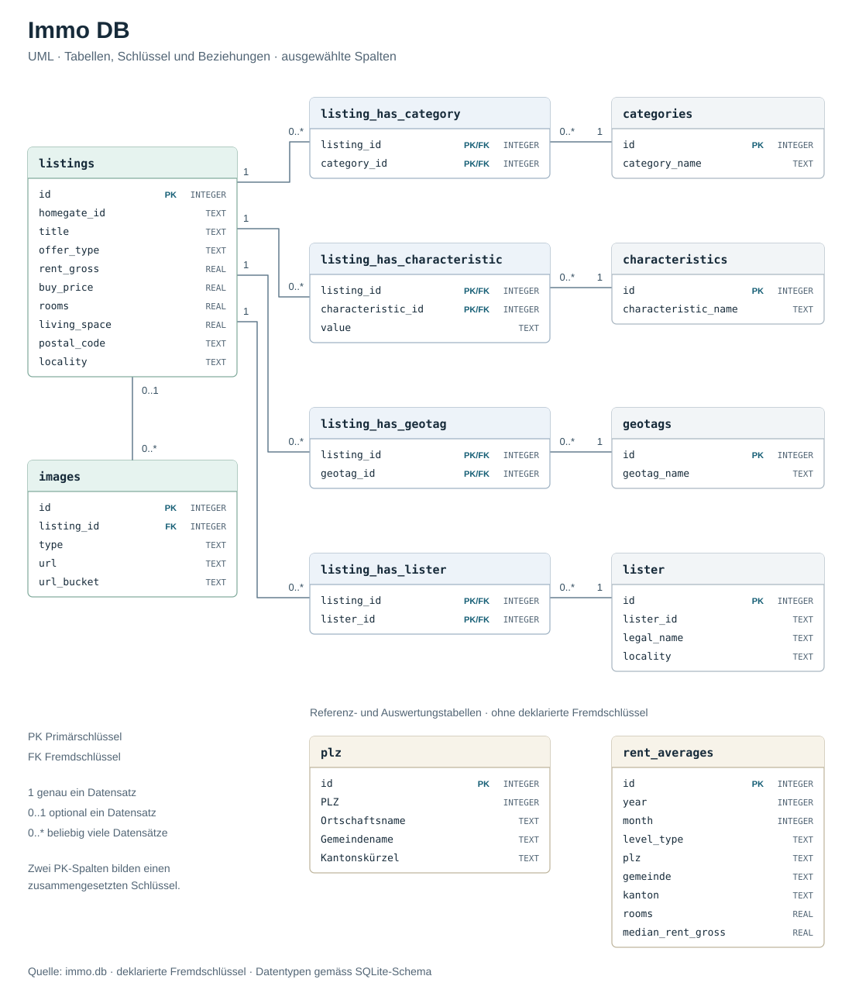

# Immo DB

185'460 Immobilien-Inserate (Miete und Kauf) von homegate.ch aus der Zeit von August bis November 2024, als SQLite-Datenbank `immo.db` (~1.2 GB).

## Datenbank herunterladen

**[immo.db.zip herunterladen](https://immo.nickschnee.ch/immo.db.zip)** (230 MB, entpackt 1.2 GB)

`immo.db` ist zu gross für GitHub und liegt deshalb nicht im Repo. Die ZIP-Datei entpacken und `immo.db` öffnen:

```bash
sqlite3 immo.db
.mode box
.tables
```

Oder in DBeaver: _Neue Verbindung → SQLite → Pfad zu `immo.db`_. Wie man SQLite und DBeaver installiert, steht in [26HS_WEEK6_SQLITE](../26HS_WEEK6_SQLITE/readme.md).

## Datenbankschema

[](assets/immo-schema.svg)

`PK` = Primärschlüssel, `FK` = Fremdschlüssel. In den Zwischentabellen bilden die beiden IDs zusammen den Primärschlüssel. `plz` und `rent_averages` haben keine deklarierten Fremdschlüssel. Das Diagramm zeigt ausgewählte Spalten; für die volle Ansicht auf das Bild klicken.

## Tabellen

| Tabelle                      | Zeilen    | Inhalt                                                                        |
| ---------------------------- | --------- | ----------------------------------------------------------------------------- |
| `listings`                   | 185'460   | Ein Inserat: Preis, Zimmer, Fläche, Adresse, Koordinaten, Titel, Beschreibung |
| `images`                     | 1'453'269 | Bilder, Grundrisse und PDFs eines Inserats                                    |
| `categories`                 | 91        | Objektarten, z.B. `APARTMENT`, `HOUSE`, `OFFICE`                              |
| `listing_has_category`       | 342'786   | Welches Inserat zu welchen Kategorien gehört (n:m)                            |
| `characteristics`            | 90        | Eigenschaften, z.B. `hasBalcony`, `arePetsAllowed`, `floor`                   |
| `listing_has_characteristic` | 1'560'248 | Welches Inserat welche Eigenschaft hat, mit Wert (n:m)                        |
| `geotags`                    | 7'858     | Orte, z.B. `geo-city-luzern`, `geo-canton-luzern`                             |
| `listing_has_geotag`         | 1'080'397 | Welches Inserat zu welchen Orten gehört (n:m)                                 |
| `lister`                     | 4'444     | Anbieter (meist Immobilienfirmen), mit Pseudonym und Ort                      |
| `listing_has_lister`         | 185'460   | Wer ein Inserat anbietet                                                      |
| `plz`                        | 5'771     | Schweizer Postleitzahlen mit Gemeinde und Kanton (amtliches Verzeichnis)      |
| `rent_averages`              | 549       | Median-Mieten pro Kanton, Gemeinde und Schweiz (August 2024)                  |

## Beispiel-Queries

Die günstigsten Wohnungen mit mindestens 3 Zimmern in Bern:

```sql
SELECT l.id, l.title, l.rooms, l.living_space, l.rent_gross
FROM listings l
JOIN listing_has_category lc ON lc.listing_id = l.id
JOIN categories c ON c.id = lc.category_id
WHERE c.category_name = 'APARTMENT'
  AND l.offer_type = 'RENT'
  AND l.locality = 'Bern'
  AND l.rooms >= 3
  AND l.rent_gross IS NOT NULL
ORDER BY l.rent_gross
LIMIT 10;
```

Die Bilder eines Inserats:

```sql
SELECT type, url_bucket
FROM images
WHERE listing_id = 17125;
```

Alle Eigenschaften eines Inserats:

```sql
SELECT c.characteristic_name, lc.value
FROM listing_has_characteristic lc
JOIN characteristics c ON c.id = lc.characteristic_id
WHERE lc.listing_id = 17125;
```

Anzahl Mietinserate und Durchschnittsmiete pro Kanton:

```sql
SELECT p.kanton, COUNT(*) AS inserate, ROUND(AVG(l.rent_gross)) AS miete_avg
FROM listings l
JOIN (SELECT PLZ, MIN(Kantonskürzel) AS kanton FROM plz GROUP BY PLZ) p
  ON p.PLZ = CAST(l.postal_code AS INTEGER)
WHERE l.offer_type = 'RENT' AND l.rent_gross > 0
GROUP BY p.kanton
ORDER BY inserate DESC;
```

Die Anbieter mit den meisten Inseraten:

```sql
SELECT ls.legal_name, ls.locality, COUNT(*) AS inserate
FROM listing_has_lister ll
JOIN lister ls ON ls.id = ll.lister_id
GROUP BY ls.id
ORDER BY inserate DESC
LIMIT 10;
```

Median-Miete einer 3.5-Zimmer-Wohnung im Kanton Bern:

```sql
SELECT median_rent_gross, median_rent_gross_per_sqm, count_listings_gross
FROM rent_averages
WHERE level_type = 'Kanton' AND kanton = 'BE' AND rooms = 3.5;
```
